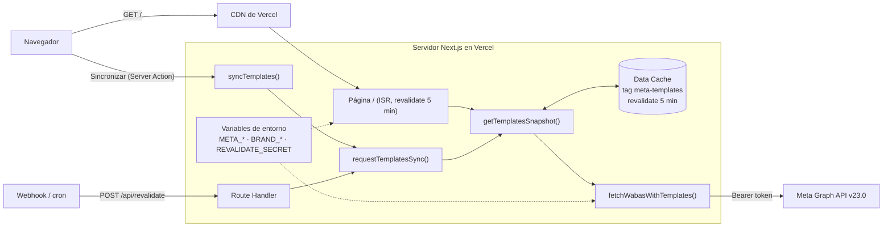
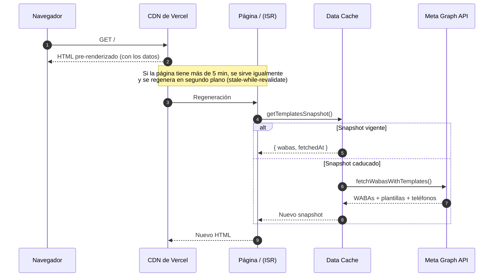
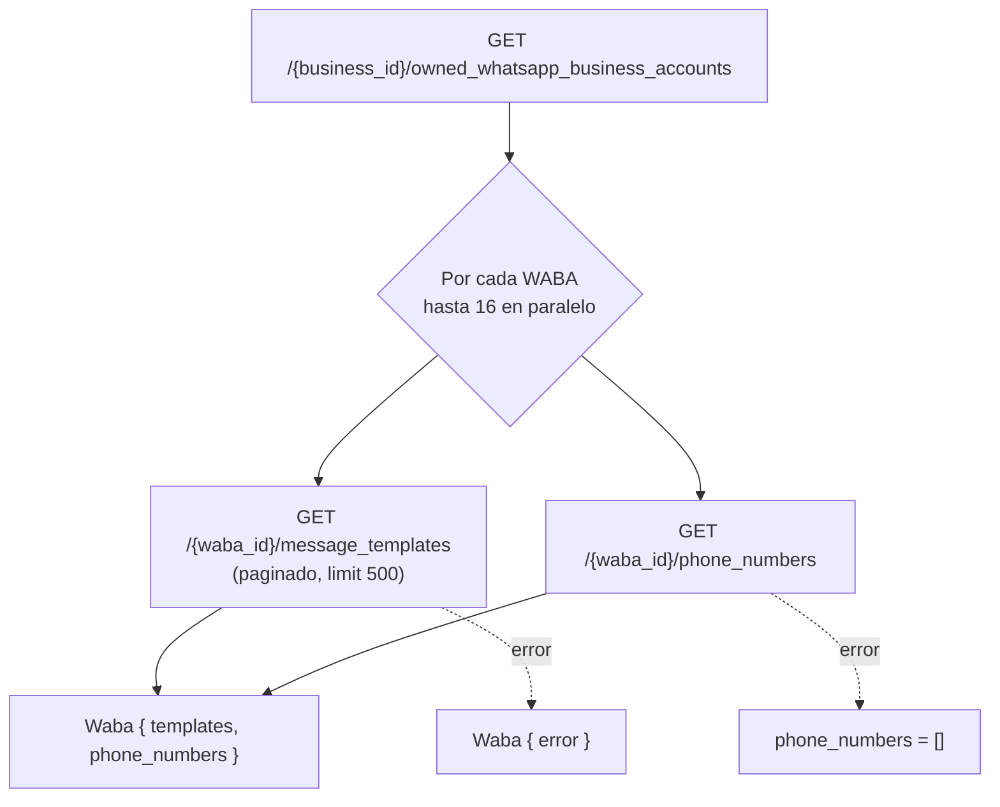
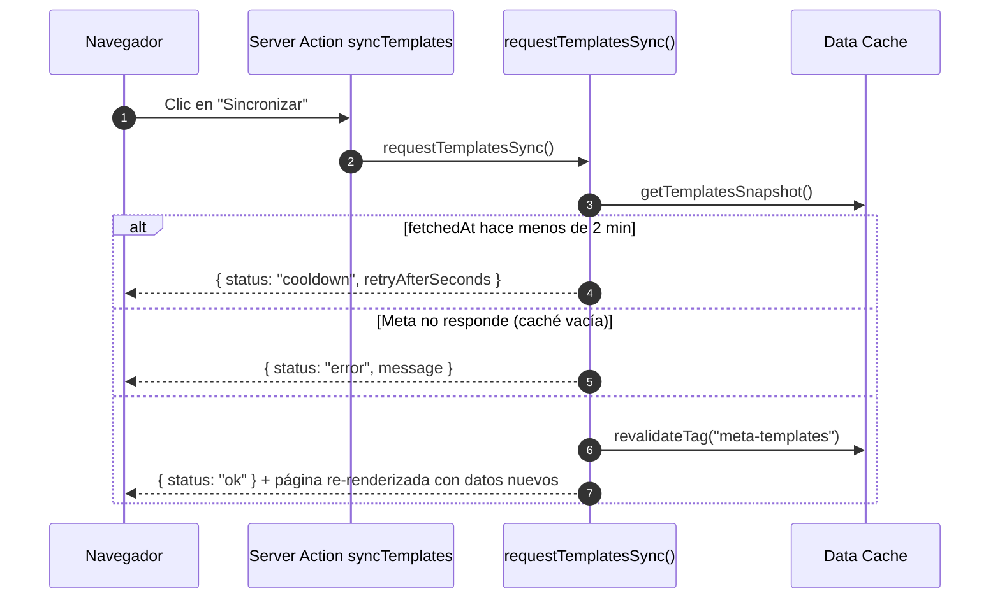
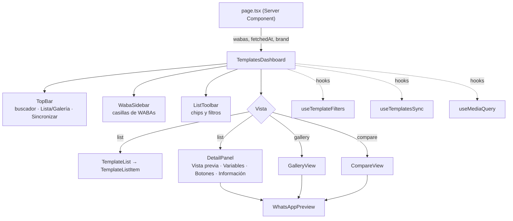
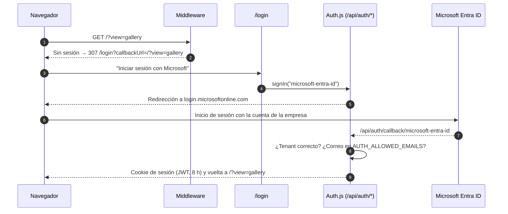
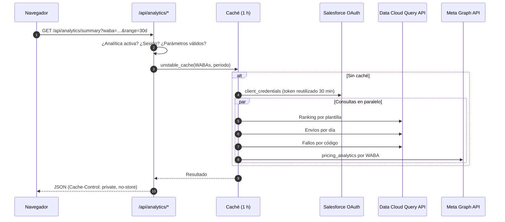
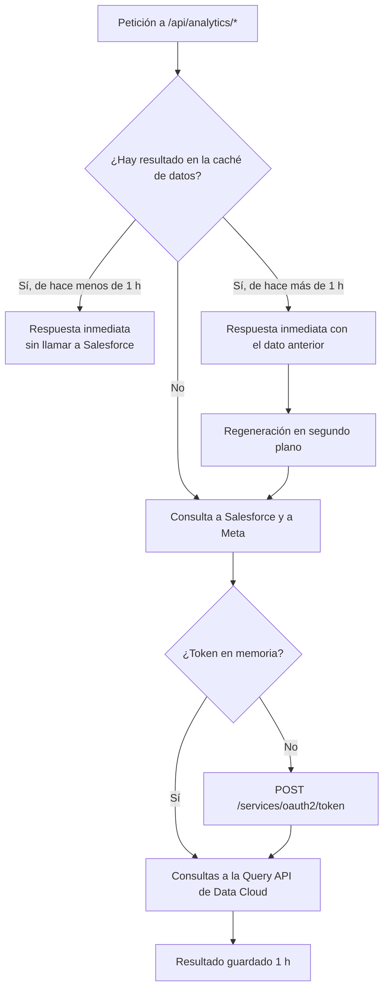

# Plantillas de WhatsApp

Aplicación web interna para consultar las plantillas de mensajes de WhatsApp Business de todas las WABAs (WhatsApp Business Accounts) de una cuenta de Meta Business. Permite buscarlas, filtrarlas por cuenta, ver cómo se muestran en WhatsApp, revisar sus variables y botones y compararlas entre sí. Es de solo lectura: la edición se hace en el WhatsApp Manager de Meta, al que la app enlaza desde cada plantilla.

Solo necesita un token de Meta. La [analítica de envíos](#analítica-salesforce-data-cloud) y el [inicio de sesión](#inicio-de-sesión-microsoft-entra-id) son módulos opcionales que se activan por configuración: quien no use Salesforce o Microsoft Entra ID no tiene que configurar nada de ellos.

## Índice

- [Funcionalidades](#funcionalidades)
- [Arquitectura](#arquitectura)
  - [Visión general](#visión-general)
  - [Renderizado y caché](#renderizado-y-caché)
  - [Obtención de datos de Meta](#obtención-de-datos-de-meta)
  - [Sincronización manual](#sincronización-manual)
  - [Cliente: componentes y estado](#cliente-componentes-y-estado)
  - [Decisiones de diseño](#decisiones-de-diseño)
  - [Seguridad](#seguridad)
  - [Observabilidad](#observabilidad)
- [Puesta en marcha](#puesta-en-marcha)
- [Variables de entorno](#variables-de-entorno)
- [Inicio de sesión (Microsoft Entra ID)](#inicio-de-sesión-microsoft-entra-id)
- [Analítica (Salesforce Data Cloud)](#analítica-salesforce-data-cloud)
- [Personalización de marca](#personalización-de-marca)
- [Despliegue en Vercel](#despliegue-en-vercel)
- [API](#api)
- [Estructura del proyecto](#estructura-del-proyecto)
- [Scripts, tests y CI](#scripts-tests-y-ci)
- [Límites conocidos](#límites-conocidos)

## Funcionalidades

| Área                     | Qué ofrece                                                                                                                                                                                                                                                                                                                                                                                       |
| ------------------------ | ------------------------------------------------------------------------------------------------------------------------------------------------------------------------------------------------------------------------------------------------------------------------------------------------------------------------------------------------------------------------------------------------ |
| **Filtro por WABA**      | Barra lateral con casillas para ver una o varias WABAs, botón "Solo" para quedarse con una, buscador de WABAs y número de plantillas que coinciden en cada una. El teléfono distingue las WABAs con el mismo nombre. Las WABAs que fallan al cargar se marcan en rojo                                                                                                                            |
| **Búsqueda**             | En nombre, cabecera, cuerpo, pie, texto, URL y teléfono de los botones, WABA e ID. Sin distinguir acentos ni mayúsculas, `_` equivale a espacio y varias palabras se buscan en cualquier orden. Las coincidencias se resaltan                                                                                                                                                                    |
| **Lista**                | Agrupada por WABA (grupos plegables), una fila por nombre de plantilla con una etiqueta por idioma (`es`, `pt_PT`…) y el fragmento donde coincide la búsqueda                                                                                                                                                                                                                                    |
| **Detalle**              | Pestañas _Vista previa_ (burbuja de WhatsApp con cabecera de texto, imagen, vídeo, documento o ubicación; modo "Con ejemplo"), _Variables_ (con su valor de ejemplo), _Botones_ (con su destino: URL, teléfono o Flow) e _Información_. Selector de idioma, aviso si Meta cambió la categoría, botones para copiar y enlace a Meta                                                               |
| **Galería**              | Todas las plantillas filtradas como burbujas de WhatsApp, agrupadas por WABA, para recorrerlas haciendo scroll                                                                                                                                                                                                                                                                                   |
| **Comparar**             | De 2 a 4 plantillas en columnas. "Resaltar diferencias" marca las palabras del cuerpo que cambian y los datos que no coinciden. "Comparar idiomas" abre todas las variantes de idioma de una plantilla                                                                                                                                                                                           |
| **Analítica**            | Opcional, con Salesforce Data Cloud. Vista _Analítica_ con envíos, entrega, lectura, tiempo hasta la lectura y fallos por WABA y origen (Marketing Cloud o Digital Engagement), detalle de un día pulsando la gráfica, ranking de plantillas, plantillas sin uso y volumen total en Meta; pestaña _Analítica_ en el detalle de cada plantilla. Ver [Analítica](#analítica-salesforce-data-cloud) |
| **Enlaces compartibles** | Búsqueda, filtros, vista, plantilla abierta y comparación se guardan en la URL                                                                                                                                                                                                                                                                                                                   |
| **Teclado**              | `/` o `Cmd+K` para buscar, `Esc` para limpiar, `↑`/`↓` para recorrer la lista                                                                                                                                                                                                                                                                                                                    |
| **Sincronización**       | Botón para traer los últimos cambios de Meta, limitado a una vez cada 2 minutos                                                                                                                                                                                                                                                                                                                  |
| **Marca**                | Logo, nombre y color de la empresa configurables por despliegue                                                                                                                                                                                                                                                                                                                                  |
| **Responsive**           | En móvil, el filtro de WABAs y el detalle se abren como paneles desde abajo                                                                                                                                                                                                                                                                                                                      |

## Arquitectura

### Visión general

Aplicación **Next.js 15 (App Router)** desplegada en **Vercel**. El servidor es el único que habla con la Meta Graph API: obtiene las WABAs y sus plantillas, las guarda en la Data Cache de Next.js y genera la página como HTML estático que Vercel sirve desde su CDN. El navegador recibe la página con todos los datos ya incluidos y hace la búsqueda, el filtrado y la navegación entre vistas en el propio cliente.



| Capa      | Tecnología                                                              |
| --------- | ----------------------------------------------------------------------- |
| Framework | Next.js 15.5 (App Router, React Server Components, ISR, Server Actions) |
| UI        | React 19, Tailwind CSS 4, fuentes Geist y Geist Mono                    |
| Lenguaje  | TypeScript                                                              |
| Datos     | Meta Graph API v23.0 (WhatsApp Business Management)                     |
| Hosting   | Vercel (Fluid Compute, CDN, Data Cache)                                 |
| Tests     | Vitest + Testing Library (jsdom y node)                                 |
| CI        | GitHub Actions (tests, lint y build en cada PR y push a `main`)         |

### Renderizado y caché

La página `/` es un Server Component con `revalidate = 300`. Next.js la genera como HTML estático (ISR) y la regenera en segundo plano como máximo cada 5 minutos. Los datos de Meta viven en un único **snapshot** (`{ wabas, fetchedAt }`) guardado en la Data Cache con `unstable_cache`, con el tag `meta-templates` y la misma revalidación de 5 minutos. En Vercel la Data Cache es compartida por todas las instancias, así que Meta recibe como mucho una regeneración cada 5 minutos, sea cual sea el tráfico.



**Errores:** los errores nunca se cachean.

- Si falla la lista de WABAs o fallan todas las WABAs, `fetchWabasWithTemplates()` lanza el error y Next.js sigue sirviendo la última versión buena.
- Si falla solo una parte de las WABAs, el snapshot se guarda con las demás y las fallidas llevan su mensaje de error, que la barra lateral muestra.
- La falta de configuración (`META_ACCESS_TOKEN` / `META_BUSINESS_ID`) se muestra como aviso en la página, para que un build sin secretos (por ejemplo, en CI) termine bien.
- Cualquier otro error durante el build hace fallar el despliegue y deja en producción la versión anterior.

**Antigüedad máxima de los datos:** la página y el snapshot se regeneran cada 5 minutos de forma independiente, así que en el peor caso los datos tienen unos 10 minutos. El literal `revalidate = 300` de `page.tsx` debe coincidir con `TEMPLATES_REVALIDATE_SECONDS` (Next.js exige un literal en esa exportación).

### Obtención de datos de Meta

`src/lib/meta-api.ts` reúne todas las WABAs del negocio con sus plantillas y teléfonos:



| Aspecto              | Valor                                                                                                                                 |
| -------------------- | ------------------------------------------------------------------------------------------------------------------------------------- |
| Versión de la API    | `v23.0`                                                                                                                               |
| Autenticación        | Cabecera `Authorization: Bearer <META_ACCESS_TOKEN>`                                                                                  |
| Timeout por petición | 15 s                                                                                                                                  |
| Concurrencia         | 16 WABAs a la vez (con ~70 WABAs, unos 5 s por regeneración)                                                                          |
| Paginación           | Se siguen todos los `paging.next`                                                                                                     |
| Campos de plantilla  | `id, name, status, category, language, components, quality_score, previous_category, sub_category, parameter_format, rejected_reason` |
| Campos de teléfono   | `id, display_phone_number, verified_name, quality_rating, status`                                                                     |
| Fallo de teléfonos   | No invalida la WABA: se muestran sus plantillas sin teléfono                                                                          |
| Mensajes de error    | Cortos en la UI (mensaje de Meta y código HTTP); el detalle (`code`, `fbtrace_id`) va a los logs                                      |

### Sincronización manual

El botón **Sincronizar** (Server Action `syncTemplates`) y `POST /api/revalidate` usan la misma función, `requestTemplatesSync()`:



- El cooldown se calcula con el `fetchedAt` del snapshot cacheado. Como esa caché es compartida, el límite es el mismo para todas las instancias y sobrevive a los cold starts sin infraestructura adicional.
- `requestTemplatesSync()` nunca lanza excepciones: devuelve siempre `ok`, `cooldown` o `error`.
- En el cliente, el botón muestra la cuenta atrás, respeta el cooldown al cargar la página (limitado a 2 minutos aunque el reloj del usuario esté desajustado) y también tras un error.
- La respuesta de la Server Action incluye la página renderizada de nuevo, así que la interfaz se actualiza sin recargar.

### Cliente: componentes y estado



- **`TemplatesDashboard`** concentra el estado de la pantalla: vista, plantilla seleccionada, idioma preferido, comparación y paneles de móvil.
- **`useTemplateFilters`** construye una vez por carga un índice de búsqueda normalizado (`lib/search.ts`), aplica los filtros y calcula el número de coincidencias por WABA. La búsqueda tiene un debounce de 150 ms.
- **Resaltado:** los términos de búsqueda se reparten mediante un contexto de React (`SearchTermsProvider`), de modo que cualquier componente resalta coincidencias sin pasar props.
- **Variantes de idioma:** `lib/template-groups.ts` agrupa las plantillas de una WABA por nombre. Al moverse por la lista se mantiene el idioma que se estaba mirando.
- **Comparación:** `lib/diff.ts` calcula las diferencias por palabras (subsecuencia común más larga) entre los cuerpos de las plantillas comparadas.
- **Escritorio y móvil:** el detalle y la barra lateral se montan una sola vez según el ancho (`useMediaQuery`): en línea en escritorio y como panel en móvil.

**Estado en la URL** (`lib/url-state.ts`). Se lee al montar la página y se escribe con `history.replaceState`, sin navegación:

| Parámetro               | Contenido                                     | Ejemplo                    |
| ----------------------- | --------------------------------------------- | -------------------------- |
| `q`                     | Búsqueda                                      | `q=matricula`              |
| `waba`                  | WABAs seleccionadas                           | `waba=111111111,222222222` |
| `status`, `lang`, `cat` | Filtros de estado, idioma y categoría         | `lang=es,pt_PT`            |
| `samples`               | `1` incluye las plantillas de ejemplo de Meta | `samples=1`                |
| `view`                  | `gallery` o `compare` (por defecto, lista)    | `view=compare`             |
| `t`                     | Plantilla abierta                             | `t=333333333`              |
| `cmp`                   | Plantillas en la comparación (máx. 4)         | `cmp=333333333,444444444`  |

### Decisiones de diseño

| Decisión                                                 | Motivo                                                                                                                |
| -------------------------------------------------------- | --------------------------------------------------------------------------------------------------------------------- |
| Página estática con ISR y datos incluidos en el HTML     | Carga inmediata desde la CDN y un número de llamadas a Meta independiente del número de usuarios                      |
| Un único snapshot en la Data Cache con tag               | Permite invalidarlo de golpe al sincronizar y compartirlo entre instancias                                            |
| Cooldown basado en `fetchedAt` del snapshot              | Limita las sincronizaciones de forma global sin Redis ni base de datos                                                |
| Errores fuera de la caché y "fallo total" como excepción | Un problema puntual de Meta no sustituye datos buenos por una página de error                                         |
| Búsqueda y filtrado en el cliente                        | Respuesta instantánea; ~600 plantillas caben de sobra en memoria                                                      |
| Estado de la pantalla en la URL                          | Cualquier búsqueda, plantilla o comparación se comparte con un enlace                                                 |
| Galería y comparación renderizadas solo al elegirlas     | La página inicial pesa ~660 KB (67 KB comprimida); la galería usa `content-visibility` para que el scroll siga fluido |
| Marca por variables de entorno                           | Cada despliegue lleva el logo y el color de su empresa sin tocar código                                               |
| Solo lectura                                             | La fuente de verdad y los permisos de edición siguen en Meta                                                          |

### Seguridad

- El token de Meta solo se usa en el servidor y nunca llega al navegador.
- `POST /api/revalidate` exige el secreto `REVALIDATE_SECRET` en la cabecera `x-revalidate-secret`, comparado en tiempo constante. Sin secreto configurado, el endpoint responde siempre 401.
- Las URLs de logo de la marca solo admiten `https://` o rutas de `/public`.
- La analítica solo se activa con el inicio de sesión activo (o en `npm run dev`). Sus endpoints exigen sesión, responden con `Cache-Control: private, no-store` y validan cada parámetro con un patrón estricto antes de construir el SQL. Las credenciales de Salesforce solo se usan en el servidor.
- El acceso se protege con [inicio de sesión de Microsoft Entra ID](#inicio-de-sesión-microsoft-entra-id), que se activa por configuración. La **Deployment Protection** de Vercel es una alternativa para restringir el acceso sin tocar la app.

### Observabilidad

El servidor escribe líneas JSON en los logs, visibles en Vercel → _Logs_:

| Evento                   | Cuándo                                               | Campos                                               |
| ------------------------ | ---------------------------------------------------- | ---------------------------------------------------- |
| `meta_templates_fetched` | Cada regeneración del snapshot                       | `wabas`, `failed`, `durationMs`                      |
| `meta_api_error`         | Cada respuesta de error de Meta                      | `context`, `status`, `code`, `message`, `fbtrace_id` |
| `sync_failed`            | Una sincronización manual no pudo contactar con Meta | `message`                                            |
| `brand_config_invalid`   | Una variable `BRAND_*` tiene un valor no válido      | `variable`, `value`                                  |
| `datacloud_query`        | Cada consulta a Data Cloud                           | `rows`, `durationMs`                                 |
| `datacloud_query_error`  | Data Cloud respondió con error                       | `status`, `body` (recortado)                         |
| `datacloud_auth_error`   | No se pudo obtener el token de Salesforce            | `status`, `error`                                    |
| `analytics_error`        | Error inesperado en un endpoint de analítica         | `message`                                            |

## Puesta en marcha

### Requisitos

- **Node.js 22** (ver `.nvmrc`; con nvm: `nvm use`).
- Una cuenta de **Meta Business** con acceso a la WhatsApp Business API.
- Un **token de System User** con el permiso `whatsapp_business_management`.

### Obtener las credenciales de Meta

1. En [Meta Business Suite](https://business.facebook.com/settings) → _Usuarios_ → _Usuarios del sistema_, crea un usuario del sistema (o usa uno existente).
2. Asígnale como activos las **cuentas de WhatsApp** que quieras ver, con permiso de lectura.
3. Genera un **token** para ese usuario con el permiso `whatsapp_business_management`. Este es `META_ACCESS_TOKEN`.
4. El identificador de la empresa aparece en _Información del negocio_ (o en la URL de Business Suite como `business_id`). Este es `META_BUSINESS_ID`.

### En local

```bash
git clone https://github.com/Gonzalez8/whatsapp-template-hub.git
cd whatsapp-template-hub
nvm use
npm install
cp .env.example .env.local   # y rellena META_ACCESS_TOKEN y META_BUSINESS_ID
npm run dev
```

Abre [http://localhost:3000](http://localhost:3000).

## Variables de entorno

| Variable                         | Obligatoria | Descripción                                                                                                                                    | Ejemplo                            |
| -------------------------------- | ----------- | ---------------------------------------------------------------------------------------------------------------------------------------------- | ---------------------------------- |
| `META_ACCESS_TOKEN`              | Sí          | Token de System User con `whatsapp_business_management`                                                                                        | `EAAG…`                            |
| `META_BUSINESS_ID`               | Sí          | ID de la cuenta de Meta Business                                                                                                               | `1234567890`                       |
| `REVALIDATE_SECRET`              | No          | Secreto de `POST /api/revalidate`. Sin él, el endpoint responde siempre 401                                                                    | cadena aleatoria larga             |
| `BRAND_NAME`                     | No          | Nombre de la empresa (junto al logo y en el título de la pestaña)                                                                              | `Acme`                             |
| `BRAND_LOGO_URL`                 | No          | Logo de la empresa: URL `https://` o ruta dentro de `/public`                                                                                  | `https://…/logo.svg`               |
| `BRAND_COLOR`                    | No          | Color de marca en hexadecimal. Por defecto, `#25D366`                                                                                          | `#F02B58`                          |
| `BRAND_LOGO_BACKGROUND`          | No          | `white` pone el logo sobre una pastilla blanca, para logos oscuros                                                                             | `white`                            |
| `AUTH_MICROSOFT_ENTRA_ID_ID`     | No          | ID de la aplicación (cliente) registrada en Entra. Activa el inicio de sesión                                                                  | `00000000-…`                       |
| `AUTH_MICROSOFT_ENTRA_ID_SECRET` | No          | Secreto de cliente de esa aplicación                                                                                                           | —                                  |
| `AUTH_MICROSOFT_ENTRA_ID_ISSUER` | No          | `https://login.microsoftonline.com/<tenant-id>/v2.0`                                                                                           | —                                  |
| `AUTH_SECRET`                    | Con login   | Clave para cifrar la sesión. Se genera con `npx auth secret`                                                                                   | —                                  |
| `AUTH_ALLOWED_EMAILS`            | No          | Lista de correos con acceso, separados por comas. Sin ella, entra cualquier cuenta del tenant                                                  | `ana@empresa.com,luis@empresa.com` |
| `SF_INSTANCE_URL`                | No          | URL `https://` de la org de Salesforce con Data Cloud. Activa la analítica                                                                     | `https://<org>.my.salesforce.com`  |
| `SF_CLIENT_ID`                   | No          | Consumer key de la External Client App (flujo client credentials)                                                                              | —                                  |
| `SF_CLIENT_SECRET`               | No          | Consumer secret de esa aplicación                                                                                                              | —                                  |
| `SF_ACCESS_TOKEN`                | No          | Solo para desarrollo: token de sesión en lugar de `SF_CLIENT_ID`/`SF_CLIENT_SECRET`                                                            | ver [abajo](#desarrollo-en-local)  |
| `ANALYTICS_WITHOUT_LOGIN`        | No          | `true` activa la analítica sin inicio de sesión **solo en previews** de Vercel (se ignora en producción). Úsala solo con Deployment Protection | `true`                             |
| `DATACLOUD_WHATSAPP_DLO`         | No          | Objeto de Data Cloud con los eventos de WhatsApp, si no es el de por defecto                                                                   | `MessagingEventsWhatsAppV2_…__dll` |

`.env.example` contiene la plantilla completa.

## Inicio de sesión (Microsoft Entra ID)

El inicio de sesión se activa **por configuración**:

| Variables `AUTH_MICROSOFT_ENTRA_ID_*`    | Comportamiento                                                       |
| ---------------------------------------- | -------------------------------------------------------------------- |
| Ninguna definida                         | Sin inicio de sesión: la app es accesible para cualquiera con la URL |
| Todas definidas, junto con `AUTH_SECRET` | Toda la app exige iniciar sesión con una cuenta Microsoft del tenant |
| Solo algunas                             | La app no se abre: `/login` indica qué variables faltan              |



- **Qué protege:** el middleware (`src/middleware.ts`) exige sesión en todas las rutas salvo `/login`, `/api/auth/*`, `/api/revalidate` (que tiene su propio secreto) y los recursos estáticos. La Server Action de sincronizar comprueba la sesión por su cuenta.
- **La página sigue siendo estática:** la sesión se comprueba antes de servirla. El nombre del usuario y el botón **Salir** se cargan en el navegador (`/api/auth/session`).
- **Cuentas admitidas:** solo las del tenant indicado en `AUTH_MICROSOFT_ENTRA_ID_ISSUER`. Con `AUTH_ALLOWED_EMAILS`, solo los correos de la lista.
- **Implementación:** [Auth.js](https://authjs.dev) v5 (`next-auth@5.0.0-beta.32`, versión fijada) con el proveedor de Microsoft Entra ID. La configuración vive en `src/auth.ts` y `src/lib/auth-config.ts`.

### Registro de la aplicación en Entra

Lo hace un administrador de Entra (o cualquier usuario, si el tenant lo permite) en _portal.azure.com → Registros de aplicaciones → Nuevo registro_:

| Ajuste                   | Valor                                                                                                                                     |
| ------------------------ | ----------------------------------------------------------------------------------------------------------------------------------------- |
| Tipos de cuenta          | Solo las cuentas de este directorio organizativo (un solo inquilino)                                                                      |
| URI de redirección (Web) | `https://<dominio>/api/auth/callback/microsoft-entra-id` (y `http://localhost:3000/api/auth/callback/microsoft-entra-id` para desarrollo) |
| Permisos delegados       | `openid`, `profile`, `email`, `User.Read` (con consentimiento de administrador)                                                           |
| Secreto de cliente       | _Certificados y secretos → Nuevo secreto de cliente_                                                                                      |

Del registro salen el **ID de aplicación (cliente)** → `AUTH_MICROSOFT_ENTRA_ID_ID`, el **ID de directorio (inquilino)** → `AUTH_MICROSOFT_ENTRA_ID_ISSUER` y el **secreto** → `AUTH_MICROSOFT_ENTRA_ID_SECRET`.

Cada dominio desde el que se use la app (producción y, si se quiere, la URL fija de una rama de preview) necesita su URI de redirección en el registro. Las URLs aleatorias de cada preview no sirven para iniciar sesión.

Para probar el flujo completo sin el tenant de la empresa, basta una cuenta gratuita de Azure: crea un directorio propio donde registrar una aplicación de prueba.

## Analítica (Salesforce Data Cloud)

Módulo **opcional** para quien envía sus plantillas desde Salesforce y tiene Data Cloud: métricas de envío de las plantillas a partir de los eventos de WhatsApp que Salesforce guarda en Data Cloud, junto con el volumen que Meta factura por WABA.

Sin las variables `SF_*` el módulo no existe para el usuario: no aparece la vista ni la pestaña _Analítica_, los endpoints responden 404 y no se hace ninguna llamada a Salesforce. El resto de la app funciona igual. El objeto de Data Cloud de otra org se indica con `DATACLOUD_WHATSAPP_DLO`.

| Dónde                                 | Qué muestra                                                                                                                                                                                                                                                                                                                                                                                                                                                                                                                                                                                                                                                                                                                                                                                             |
| ------------------------------------- | ------------------------------------------------------------------------------------------------------------------------------------------------------------------------------------------------------------------------------------------------------------------------------------------------------------------------------------------------------------------------------------------------------------------------------------------------------------------------------------------------------------------------------------------------------------------------------------------------------------------------------------------------------------------------------------------------------------------------------------------------------------------------------------------------------- |
| Vista **Analítica** (Lista · Galería) | Para las WABAs marcadas en la barra lateral (o todas), en dos bloques. **«Todo WhatsApp, según Meta»** (_Fuente: Meta_): plantillas entregadas desde cualquier herramienta, repartidas entre Marketing Cloud, Digital Engagement y fuera de Salesforce; conversaciones de servicio; volumen por categoría, de pago y gratis; y la tabla «Quién envía las plantillas» por WABA. **«Detalle de Salesforce»** (_Fuente: Data Cloud_): enviadas, % entregadas, % leídas, tiempo hasta la lectura (mediana) y fallos (evitables / ruido); envíos por día (por semana en _Todo_); reparto por origen; ranking de plantillas; fallos por motivo; plantillas sin envíos. Su filtro de origen (todo Salesforce, Marketing Cloud o Digital Engagement) solo afecta a este bloque. Periodos: 7, 30, 90 días o todo |
| Pestaña **Analítica** del detalle     | Lo mismo para una plantilla e idioma, más su tasa de lectura y su tiempo hasta la lectura frente a los de su WABA en el mismo periodo                                                                                                                                                                                                                                                                                                                                                                                                                                                                                                                                                                                                                                                                   |

La vista, el periodo, el origen, el día elegido y la pestaña se guardan en la URL (`view=analytics`, `range=`, `origin=`, `day=`, `tab=analytics`). Desde el ranking y desde la lista de plantillas sin envíos se abre el detalle de la plantilla en su pestaña _Analítica_.

- **Detalle de un día:** al pulsar una barra de la gráfica (o una semana, en _Todo_), los KPIs, el volumen de Meta, el ranking, los fallos y el origen pasan a ese día; la gráfica sigue mostrando el periodo completo para poder elegir otro. Se vuelve con _Ver todo el periodo_ o pulsando la misma barra.
- **Origen:** el campo `Application__c` del envío distingue **Marketing Cloud** (`MARKETING_CLOUD_ENGAGEMENT`) y **Digital Engagement** (`DIGITAL_ENGAGEMENT`). Los dos son Salesforce y los registra Data Cloud. Lo enviado desde otras herramientas no está en Data Cloud: solo aparece en el bloque de Meta.
- **Fuera de Salesforce:** Meta solo cuenta (y cobra) los mensajes **entregados**, así que se compara con las **entregadas** de Salesforce, no con las enviadas: _fuera de Salesforce ≈ plantillas entregadas según Meta − plantillas entregadas según Data Cloud_, por WABA y en total (nunca negativo). Una WABA que solo envía desde Salesforce da 0 (por ejemplo, NoriBot: 758 entregadas en Data Cloud y 758 de Utilidad en Meta). La tabla «Quién envía» marca «Todo fuera» las WABAs sin ningún envío desde Salesforce y «Todo Salesforce» las que no tienen diferencia. En _Todo_, el bloque de Meta compara los últimos 90 días de ambas fuentes, porque Meta no guarda más.
- **Tiempo hasta la lectura:** mediana de los minutos entre el envío y la primera confirmación de lectura, solo entre los mensajes leídos.
- **Plantillas sin envíos:** plantillas **aprobadas** en Meta sin ningún envío desde Salesforce en los últimos 90 días (candidatas a limpiar), y plantillas enviadas en ese tiempo que ya no existen en Meta. Una plantilla que se envía desde otra herramienta aparece como «sin envíos» aunque se use.
- **Días:** Data Cloud agrupa los días en UTC (su SQL no admite zonas horarias con nombre) y Meta en la zona horaria de la WABA. Los envíos entre las 22:00 y las 24:00 UTC (medianoche en España) pueden caer en días distintos en una y otra fuente; los totales de varios días coinciden.

### Cuándo se activa

| Configuración                                                                           | Analítica                                                                     |
| --------------------------------------------------------------------------------------- | ----------------------------------------------------------------------------- |
| Sin `SF_INSTANCE_URL` o sin credenciales                                                | No aparece                                                                    |
| Con Data Cloud y con [inicio de sesión](#inicio-de-sesión-microsoft-entra-id)           | Activa; los endpoints exigen sesión                                           |
| Con Data Cloud, sin inicio de sesión, en `npm run dev`                                  | Activa, para desarrollar con datos reales                                     |
| Con Data Cloud, sin inicio de sesión, en una preview con `ANALYTICS_WITHOUT_LOGIN=true` | Activa, sin sesión. Pensado para previews con Deployment Protection de Vercel |
| Con Data Cloud, sin inicio de sesión, desplegada                                        | No aparece: son datos de negocio y no se exponen en una URL abierta           |

### Cómo funciona



- **Origen de los datos:** el objeto de Data Cloud con los eventos de WhatsApp (`DATACLOUD_WHATSAPP_DLO`). Cada mensaje tiene varias filas con el mismo `WhatsAppWamId__c`: el envío desde Salesforce (`SEND_STATUS`, con la plantilla y el idioma dentro de `Message__c`) y los acuses de Meta (`DR`: enviado, entregado, leído, fallido). La app toma el envío y su estado final.
- **Métricas:** _Entregadas_ = entregadas o leídas / enviadas; _Leídas_ = leídas / entregadas; _Tiempo hasta lectura_ = mediana (`approx_percentile`) de los segundos entre el envío y la primera lectura; _Fallos_ = fallidos o rechazados antes de llegar a Meta. Un fallo es **evitable** si su código depende de nuestra configuración o datos (`SF-3060`, `100`, `132000`, `132015`, `132001`, `131008`, `131005`, `190`, `10`, `131053`: Meta no pudo descargar la imagen o el vídeo de la cabecera, casi siempre por una URL nuestra caducada o privada) y **ruido** en otro caso (número sin WhatsApp, límites de marketing de Meta…).
- **Total en Meta:** `pricing_analytics` de cada WABA, por categoría y de pago o gratis. Cuenta los mensajes de **todos los orígenes**, no solo de Salesforce, e incluye mensajes que no son plantillas. Meta guarda 90 días, así que en _Todo_ muestra los últimos 90. Cada categoría lleva un icono ⓘ que muestra su explicación al pasar el ratón, tocarlo o enfocarlo con el teclado:

  | Categoría      | Qué es                                                                 | Coste                                              |
  | -------------- | ---------------------------------------------------------------------- | -------------------------------------------------- |
  | Marketing      | Plantillas promocionales                                               | Siempre de pago (tarifa más alta)                  |
  | Marketing Lite | Plantillas de marketing enviadas por la Marketing Messages API de Meta | De pago, con la tarifa de marketing                |
  | Utilidad       | Confirmaciones, recordatorios y avisos                                 | De pago, gratis dentro de una conversación abierta |
  | Autenticación  | Códigos de verificación (OTP)                                          | Siempre de pago                                    |
  | Servicio       | Respuestas libres a un cliente que ha escrito; no son plantillas       | Gratis                                             |

  Meta cobra por mensaje entregado. Una conversación abierta es la ventana de 24 h que empieza cuando el cliente escribe (72 h si llega desde un anuncio de clic a WhatsApp). _Gratis_ son los mensajes que Meta marca como enviados en una ventana gratuita (`FREE_CUSTOMER_SERVICE`, `FREE_ENTRY_POINT`) y **todos** los de Servicio: Meta devuelve parte de ellos con el tipo `REGULAR` (tarifa estándar), pero la tarifa de servicio es cero. El resto es _De pago_.

- **SQL seguro:** WABA, plantilla, idioma, fecha y nombre del objeto se validan contra patrones estrictos (`src/lib/analytics/queries.ts`); un valor que no encaja responde 400 sin llegar a Data Cloud.

### Caché y llamadas a Salesforce

La analítica no consulta Salesforce en cada visita. Hay tres niveles:

| Nivel                           | Qué guarda                                                                                                                                     | Duración                                            | Dónde vive                                                           |
| ------------------------------- | ---------------------------------------------------------------------------------------------------------------------------------------------- | --------------------------------------------------- | -------------------------------------------------------------------- |
| **Caché de datos** del servidor | El resultado de cada combinación: WABAs seleccionadas + periodo + origen + día elegido (vista) o WABA + plantilla + idioma + periodo (pestaña) | **1 hora** (`unstable_cache`, etiqueta `analytics`) | Data Cache de Vercel, compartida por todas las instancias y usuarios |
| **Token de Salesforce**         | El token del flujo client credentials                                                                                                          | 30 min, o hasta que Data Cloud responda 401         | Memoria de cada instancia de la función                              |
| **Caché del navegador**         | Las respuestas ya cargadas en la pestaña                                                                                                       | Mientras no se recargue la página                   | Memoria del navegador                                                |



**Cuántas llamadas hace cada resultado no cacheado:**

| Petición                                   | Data Cloud                                                                                                                                                                                                                                                                                                                                                                                                                                                                 | Meta                                                               |
| ------------------------------------------ | -------------------------------------------------------------------------------------------------------------------------------------------------------------------------------------------------------------------------------------------------------------------------------------------------------------------------------------------------------------------------------------------------------------------------------------------------------------------------- | ------------------------------------------------------------------ |
| Vista Analítica (WABAs + periodo + origen) | 5 consultas en paralelo por resumen: ranking, envíos por día, fallos, totales por origen (con la mediana) y entregadas por WABA y origen. La vista pide hasta tres resúmenes: el del bloque de Salesforce (con su origen), el del bloque de Meta (todos los orígenes; es el mismo cuando no hay filtro) y el de 90 días para las plantillas sin envíos. Elegir un día pide los de ese día. Las peticiones iguales se comparten, en el navegador y en la caché del servidor | 1 llamada a `pricing_analytics` por WABA (16 a la vez como máximo) |
| Pestaña Analítica (plantilla + periodo)    | 3 consultas: envíos por día, fallos y totales, más el resumen de su WABA (que reutiliza la caché de la vista si ya está)                                                                                                                                                                                                                                                                                                                                                   | Las del resumen de su WABA, si no estaba en caché                  |
| Token                                      | 1 petición OAuth cada 30 min por instancia                                                                                                                                                                                                                                                                                                                                                                                                                                 | —                                                                  |

En la práctica, cada combinación distinta consulta Salesforce **como mucho una vez por hora**, la vean una o cien personas. Volver a una WABA o a un periodo ya vistos en la misma pestaña no hace ninguna petición.

- **Refresco:** a partir de la hora, la siguiente visita recibe el dato anterior al instante y dispara la regeneración en segundo plano (_stale-while-revalidate_). Si esa regeneración falla, se sigue sirviendo el dato anterior. La nota al pie indica la antigüedad de las cifras («estas, hace 12 min»).
- **Errores:** un fallo de Salesforce no se guarda en caché; la siguiente petición vuelve a intentarlo.
- **El botón Sincronizar** solo refresca las plantillas de Meta, no la analítica. No hace falta: Data Cloud ya va unos 15 minutos por detrás de Meta y las métricas son diarias.
- **Consultas acotadas:** cada consulta filtra por WABA y por fecha, y agrupa en Data Cloud; a la app solo llegan los totales, nunca eventos sueltos.
- **Tiempos de espera:** 30 s por consulta a Data Cloud y 15 s por llamada a Meta.

Los tiempos están en `src/lib/analytics/index.ts` (`ANALYTICS_REVALIDATE_SECONDS`) y `src/lib/datacloud.ts` (`TOKEN_TTL_MS`, `QUERY_TIMEOUT_MS`).

### Qué pedir al administrador de Salesforce

1. Una **External Client App** (o Connected App) con el flujo **Client Credentials** activado y los ámbitos OAuth `api` y `cdp_query_api`.
2. Un **usuario de integración** de solo lectura como usuario de ejecución del flujo, con acceso de lectura al objeto de Data Cloud de WhatsApp.
3. Su **consumer key** → `SF_CLIENT_ID` y **consumer secret** → `SF_CLIENT_SECRET`, más la URL de la org → `SF_INSTANCE_URL`.

### Desarrollo en local

Sin External Client App, se puede usar la sesión de la CLI de Salesforce:

```bash
sf org login web -a produccion
SF_INSTANCE_URL=https://<org>.my.salesforce.com \
SF_ACCESS_TOKEN=$(sf org auth show-access-token -o produccion --json | jq -r .result.accessToken) \
npm run dev
```

El token caduca con la sesión; cuando Data Cloud responda 401, se vuelve a lanzar el comando.

## Personalización de marca

Con las variables `BRAND_*` cada despliegue lleva la identidad de su empresa:

- **Cabecera:** con logo o nombre de empresa, la barra superior muestra **[logo de la empresa] │ [icono de WhatsApp en gris] Plantillas de WhatsApp**. Sin marca configurada, el icono de WhatsApp va en su insignia verde.
- **Color de marca:** es el acento de la interfaz (botones principales, selección, casillas, chips y pestaña activa). `src/lib/brand.ts` deriva automáticamente:
  - el color del texto sobre el acento (oscuro o blanco, el que mejor contraste);
  - una versión oscurecida para textos sobre blanco (contraste WCAG AA, 4,5:1);
  - una versión aclarada para las barras oscuras, para que también se vea un color de marca oscuro.
- **Valores no válidos:** se ignoran, se usa el diseño por defecto y se registra un aviso `brand_config_invalid`.
- **Aplicación de cambios:** como la página es estática, un cambio en estas variables se aplica al **redesplegar**.

## Despliegue en Vercel

1. Importa el repositorio en Vercel (framework detectado: Next.js).
2. En _Settings → Environment Variables_, define `META_ACCESS_TOKEN`, `META_BUSINESS_ID` y, opcionalmente, `REVALIDATE_SECRET`, las `BRAND_*`, las `AUTH_*` y las `SF_*`. Márcalas en **Production** y, si quieres verlas también en las previews, en **Preview**.
3. Cada push a una rama genera una **preview**, y cada merge a `main` despliega en **producción**.
4. Para restringir el acceso, activa _Settings → Deployment Protection_.

Tras cambiar una variable de entorno: _Deployments → ⋯ → Redeploy_.

## API

### `POST /api/revalidate`

Fuerza una sincronización con Meta, por ejemplo desde un webhook o un cron.

```bash
curl -X POST https://<dominio>/api/revalidate -H "x-revalidate-secret: $REVALIDATE_SECRET"
```

| Respuesta | Significado                                                                 |
| --------- | --------------------------------------------------------------------------- |
| `200`     | `{ "revalidated": true }`: la siguiente visita trae datos nuevos            |
| `401`     | Secreto ausente o incorrecto                                                |
| `429`     | Datos de hace menos de 2 min; la cabecera `Retry-After` indica los segundos |
| `502`     | No se pudo contactar con Meta                                               |

### `GET /api/analytics/summary` y `GET /api/analytics/template`

Los usa la interfaz de [analítica](#analítica-salesforce-data-cloud); exigen sesión cuando el inicio de sesión está activo.

| Endpoint                  | Parámetros                                                                                                                                                                                                                                 |
| ------------------------- | ------------------------------------------------------------------------------------------------------------------------------------------------------------------------------------------------------------------------------------------ |
| `/api/analytics/summary`  | `range` (`7d`, `30d`, `90d`, `all`), `waba` (IDs separados por comas; vacío = todas las WABAs), `origin` (`mce` o `de`; sin él, todos) y opcionalmente `from` y `to` (`YYYY-MM-DD`, `to` excluido) para un día o una semana, de 1 a 7 días |
| `/api/analytics/template` | `range`, `waba`, `name` y `lang` de la plantilla                                                                                                                                                                                           |

| Respuesta | Significado                                   |
| --------- | --------------------------------------------- |
| `200`     | Métricas en JSON                              |
| `400`     | Parámetro ausente o no válido                 |
| `401`     | Sin sesión                                    |
| `404`     | Analítica desactivada                         |
| `502`     | Data Cloud no respondió o rechazó la consulta |

## Estructura del proyecto

```
src/
  auth.ts                    # Configuración de Auth.js (Microsoft Entra ID)
  middleware.ts              # Exige sesión cuando el inicio de sesión está activo
  app/
    page.tsx                 # Página (Server Component, ISR); lee la marca y el snapshot
    layout.tsx               # Layout raíz: fuentes, metadatos y colores de marca
    error.tsx                # Error boundary
    actions.ts               # Server Action de sincronización
    login/page.tsx           # Página de inicio de sesión
    api/auth/[...nextauth]/  # Endpoints de Auth.js
    api/revalidate/route.ts  # POST /api/revalidate
    api/analytics/           # GET summary y template (analítica)
    globals.css              # Tokens de diseño (Tailwind 4 @theme)
  components/
    TemplatesDashboard.tsx   # Layout, selección, comparación, URL y teclado
    TopBar.tsx               # Marca, buscador, selector de vista y sincronización
    WabaSidebar.tsx          # Filtro de WABAs
    ListToolbar.tsx          # Chips y filtros de la lista
    TemplateList.tsx         # Lista agrupada por WABA y por nombre
    TemplateListItem.tsx     # Fila con etiquetas de idioma
    DetailPanel.tsx          # Detalle con pestañas
    TemplateDetails.tsx      # Pestañas Variables, Botones e Información
    GalleryView.tsx          # Galería de burbujas por WABA
    CompareView.tsx          # Comparación en columnas
    WhatsAppPreview.tsx      # Burbuja de WhatsApp
    Highlight.tsx            # Resaltado de coincidencias
    UserMenu.tsx             # Usuario con sesión y botón Salir
    analytics/               # Vista Analítica, pestaña del detalle y piezas comunes
  hooks/
    useTemplateFilters.ts    # Índice de búsqueda y filtros
    useTemplatesSync.ts      # Botón de sincronizar
    useMediaQuery.ts         # Escritorio / móvil
    useAnalytics.ts          # Carga de los endpoints de analítica
  lib/
    meta-api.ts              # Cliente de Meta Graph API
    templates.ts             # Snapshot cacheado y sincronización
    sync-config.ts           # Tiempos de caché y cooldown
    brand.ts                 # Marca y contraste de colores
    auth-config.ts           # Estado del inicio de sesión según el entorno
    datacloud.ts             # Cliente de la Query API de Data Cloud
    meta-analytics.ts        # Volumen de mensajes de Meta (pricing_analytics)
    analytics/               # Activación, SQL validado, caché, series y códigos de error
    search.ts                # Normalización, coincidencias y fragmentos
    template-groups.ts       # Variantes de idioma
    template-utils.ts        # Etiquetas, ejemplos y variables
    diff.ts                  # Diferencias por palabras
    url-state.ts             # Estado de la pantalla en la URL
    concurrency.ts           # allSettled con límite de concurrencia
    secret.ts                # Comparación de secretos en tiempo constante
    whatsapp-format.tsx      # Formato de texto de WhatsApp
  types/
    template.ts              # Tipos de Meta y del snapshot
  __tests__/                 # Tests (Vitest)
```

## Scripts, tests y CI

| Comando                           | Descripción                                            |
| --------------------------------- | ------------------------------------------------------ |
| `npm run dev`                     | Servidor de desarrollo                                 |
| `npm run build`                   | Build de producción (llama a Meta si hay credenciales) |
| `npm run start`                   | Servidor de producción local                           |
| `npm test`                        | Tests (Vitest)                                         |
| `npm run test:watch`              | Tests en modo watch                                    |
| `npm run lint`                    | ESLint                                                 |
| `npm run format` / `format:check` | Prettier                                               |

Los tests cubren la lógica (búsqueda, diferencias, URL, marca y contraste, sincronización, cliente de Meta, SQL y endpoints de analítica) y los componentes principales, además de un test de integración del dashboard. El CI de GitHub Actions ejecuta `npm test`, `npm run lint` y `npm run build` con Node 22 en cada pull request y en cada push a `main`.

## Límites conocidos

- Tras una sincronización manual la entrada de caché se invalida. Si Meta falla justo entonces, no hay snapshot anterior que servir y se muestra `error.tsx` hasta la siguiente carga correcta.
- La comprobación del cooldown no es atómica: dos sincronizaciones simultáneas pueden regenerar las dos (como mucho, una llamada extra a Meta).
- Si Meta falla durante un despliegue, el build falla y se mantiene en producción la versión anterior.
- La analítica de Data Cloud solo ve los envíos hechos desde Salesforce. Los de otros orígenes cuentan en _Total en Meta_, pero no por plantilla.
- Los envíos que Salesforce rechaza sin llegar a construir el mensaje no llevan plantilla, así que no se atribuyen a ninguna.
- Las imágenes y vídeos de las cabeceras son los ejemplos que Meta guarda con cada plantilla (URLs firmadas que se renuevan con cada sincronización).

## Contribuir

Ver [CONTRIBUTING.md](CONTRIBUTING.md).

## Licencia

[MIT](LICENSE)
